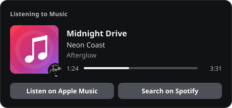

<h1 align="center">apple-music-discord-rpc</h1>

<p align="center">
  apple music → discord rich presence · windows & macOS · zero dependencies
</p>

<p align="center">
  
  
  
  
</p>

<br>

<p align="center">
  
</p>

<br>

### about

Shows what you're listening to in Apple Music on your Discord profile — track, artist,
cover art, a live progress bar and links to the song.

Runs quietly in the background: no tray icon, no Electron, no dependencies. Just Node.js
talking to Apple Music and to Discord through its local IPC socket.
Written from scratch, inspired by [NextFire/apple-music-discord-rpc](https://github.com/NextFire/apple-music-discord-rpc).

<br>

### features

- **windows & macOS** — Apple Music app or iTunes on Windows, Music.app or iTunes on Mac
- **live progress** — elapsed & remaining time, picks up skips within seconds
- **cover art & links** — artwork plus song, album and artist links from the Apple Music catalog
- **local files too** — tracks the catalog doesn't know still get their embedded artwork
- **only while playing** — clears on pause or when Apple Music quits, or keep it while paused
- **any client** — Discord, PTB, Canary, Vesktop and other arRPC clients
- **lightweight** — one Node process, cached lookups, polls slower while nothing plays
- **set & forget** — starts at login and restarts itself if anything breaks
- **signed** — small badge on the cover, hover shows *made by xr7uz*, click opens this repo

<br>

### install

Pick your system:

<details>
<summary></summary>

<br>

Windows 10 / 11 · [Apple Music app](https://apps.microsoft.com/search?query=apple+music) or iTunes · [Node.js](https://nodejs.org) 22.18+ · Git

**1.** Node.js and Git, if you don't have them yet — then open a **new** terminal:

```powershell
winget install OpenJS.NodeJS.LTS
winget install Git.Git
```

**2.** Download and install:

```powershell
git clone https://github.com/xr7uz/Apple-Music-Discord-RPC.git
cd Apple-Music-Discord-RPC
powershell -ExecutionPolicy Bypass -File scripts\install.ps1
```

Done — it runs hidden in the background and starts with Windows.

| | |
| --- | --- |
| update | `git pull` then run the install line again |
| uninstall | `powershell -ExecutionPolicy Bypass -File scripts\uninstall.ps1` |
| logs | `Get-Content "$env:LOCALAPPDATA\apple-music-discord-rpc\music-rpc.log" -Encoding UTF8 -Wait -Tail 30` |
| config | `copy .env.example .env`, edit, run the install line again |
| run in a window | `npm start` |

> Reads Apple Music through the Windows media controls (the player in the volume flyout).
> If your Apple Music version doesn't report the playback position there, the progress bar
> starts with the next song.

<br>

</details>

<details>
<summary></summary>

<br>

macOS · Music.app or iTunes · [Node.js](https://nodejs.org) 22.18+ (`brew install node`)

```sh
git clone https://github.com/xr7uz/Apple-Music-Discord-RPC.git
cd Apple-Music-Discord-RPC
./scripts/install.sh
```

On first start macOS asks whether **node** may control **Music** and **System Events** → allow.

| | |
| --- | --- |
| update | `git pull && ./scripts/install.sh` |
| uninstall | `./scripts/uninstall.sh` |
| logs | `tail -f ~/Library/Logs/apple-music-discord-rpc.log` |
| config | `cp .env.example .env`, edit, then `./scripts/install.sh` again |
| run in the foreground | `npm start` |

<br>

</details>

<br>

### config

Optional — everything lives in `.env` (see [`.env.example`](.env.example)).

| variable | default | |
| --- | --- | --- |
| `MUSIC_RPC_COUNTRY` | `us` | Apple Music storefront for artwork & links, e.g. `de` |
| `MUSIC_RPC_BUTTONS` | `apple,spotify` | up to two of `apple` `spotify` `youtube`, or `none` |
| `MUSIC_RPC_SHOW_PAUSED` | `false` | keep the presence while paused |
| `MUSIC_RPC_UPLOAD_ARTWORK` | `true` | upload local artwork to [litterbox](https://litterbox.catbox.moe) (gone after 1h) when the catalog has none |
| `MUSIC_RPC_POLL_MS` | `5000` | poll interval while Apple Music is open |
| `MUSIC_RPC_CLIENT_ID` | public "Music" app | your own [Discord application](https://discord.com/developers/applications), its name shows in "Listening to …" |
| `MUSIC_RPC_DEBUG` | `false` | verbose logs |

<br>

### how it works

```
Music.app (macOS) ───── osascript ──▶ macos.ts ────┐
Apple Music (Windows) ─ media API ──▶ windows.ts ──┼──▶ presence.ts ── ipc ──▶ Discord
iTunes Search API ──────────────────▶ lookup.ts ───┘
```

- [`macos.ts`](src/macos.ts) reads Music.app with one JXA call per tick
- [`windows.ts`](src/windows.ts) keeps one PowerShell process that reads the Windows media controls ([`windows-media.ps1`](src/windows-media.ps1))
- [`lookup.ts`](src/lookup.ts) finds the track in the catalog and caches the result
- [`presence.ts`](src/presence.ts) builds the activity, only real changes get sent
- [`discord.ts`](src/discord.ts) speaks Discord's IPC protocol directly (unix socket / named pipe), no SDK

<br>

### dev

```sh
npm install      # typescript + node types, dev only
npm run check    # typecheck
npm test         # node:test, runs on any OS
```

<br>

### stack

<p align="center">
  
</p>

<br>

<p align="center">
  <a href="https://github.com/xr7uz">
    
  </a>
  &nbsp;
  <a href="https://xr7uz.xyz">
    
  </a>
</p>

<p align="center"><sub>MIT · not affiliated with Apple or Discord</sub></p>
